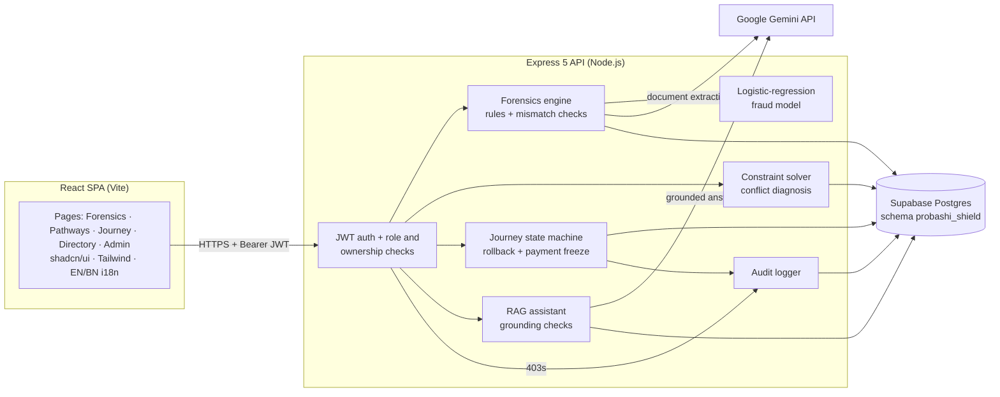

# ProbashiShield (প্রবাসী শিল্ড)

**Hack the Vibe 2026 · World Problem Solver track · Advanced challenges: A02 (Intelligent Decisions & Optimization) and A07 (Automated Multi-Step Workflow)**

| | |
|---|---|
| Live app (Vercel) | https://probashi-shield-two.vercel.app/ |
| Backend health check (Render) | https://probashi-shield.onrender.com/api/health. A keep-alive check calls it every 5 minutes, so the Render instance and the 60-second A07 expiry sweep stay active. |
| Demo video | _added after recording_ |
| Test accounts | See [Test accounts](#test-accounts) |

ProbashiShield helps Bangladeshi migrant workers avoid recruitment fraud before they leave the country. A worker checks their offer letter and fee receipt for illegal overcharges, finds a legal migration route that fits their salary and budget, and tracks the seven pre-departure steps. When a clearance expires partway through, the system repairs the journey by itself.

---

## The problem

- **Fee overcharging:** the government cap for Malaysia was 78,990 BDT, yet workers report paying up to five times that.
- **Middlemen:** over half of migration spending goes to unaccredited middlemen (dalals). Workers cannot check whether an agency is licensed or whether their documents agree with each other.
- **Failures mid-journey:** clearances such as the medical certificate expire. Workers find out late, after paying for later steps, and their families are not told.

**Users:** prospective migrant workers, a family nominee who watches the journey, and a caseworker or admin who monitors fraud and maintains the fee rules.

## What it does

| Module | What the user gets |
|---|---|
| **1. Document forensics** | Upload an offer letter, receipt or demand letter, or enter it by hand. Gemini reads the document; deterministic rules then check the fee against the legal cap (Green / Amber / Red), cross-check documents for mismatched agency licences or destinations, flag missing salary clauses, and look up the agency in the registry. An explainable ML score estimates fraud risk and lists its top factors. |
| **2. Pathway optimizer (A02)** | Enter a destination, minimum salary and budget. The engine returns legal routes with verified agencies. If none exists, it names the **exact constraints that conflict** and suggests the **smallest change** that makes the request feasible, which can be applied in one click. |
| **3. Self-healing journey (A07)** | A 7-step pre-departure pipeline: Agency verification → Medical → Police clearance → Training → Immigration → Visa → Flight. If a passed step expires or fails, later steps reopen, flight readiness is revoked, payments freeze, and the nominee is alerted automatically. A recovery plan says what to do next. |
| **Extras** | Agency and corridor directory (search, filter, sort); admin command centre with live KPIs, the audit and security log, and fee-rule editing; a grounded RAG assistant that answers in Bangla, Banglish or English and cites its sources; Bangla/English UI; Light, Dark and System themes. |

The three modules form one flow: **audit documents → choose a legal pathway → start and track the journey**.

## Architecture



**Design principle: the LLM reads, code decides.** Gemini only turns messy document text into structured fields. Every verdict (fee band, mismatch, registry status, journey transition) comes from deterministic, versioned rules that can be tested and explained. If Gemini times out, returns malformed data or is unavailable, the app falls back to manual entry and the rules still run. The AI assistant answers only from retrieved database records, and a reply is rejected if it misses the fee cap, gives a wrong helpline number or leaks prompt details.

### Tech stack

| Layer | Choice |
|---|---|
| Frontend | React 19, Vite, React Router 7, Tailwind CSS v4, shadcn/ui (Base UI), lucide icons, sonner toasts |
| Backend | Node.js, Express 5, `pg`, `jsonwebtoken` (HS256), `bcryptjs`, `multer` (in-memory uploads) |
| Database | PostgreSQL on Supabase, dedicated `probashi_shield` schema, verified TLS |
| AI | Google Gemini (`@google/generative-ai`) with model fallback, timeouts and a deterministic fallback |
| Tests | `node --test` for the journey engine |

### Data model

`users` · `agencies` · `corridors` (fee cap, salary range, risk level, rule source, effective date) · `documents` (SHA-256 hash, unique per worker) · `audit_checks` · `journeys` · `journey_steps` (7 per journey) · `audit_logs` (append-only trail). Foreign keys, `CHECK` constraints and unique indexes keep the data consistent. See [server/db/schema.sql](server/db/schema.sql).

## How the advanced challenges work

### A02: Intelligent decisions and optimization

[server/services/pathwayOptimizer.js](server/services/pathwayOptimizer.js)

1. Each corridor is checked against every constraint: destination, minimum salary (compared with the corridor's salary ceiling), budget (compared with the legal fee cap) and risk tolerance. The violations are stored as a bitmask, and money is handled in integer cents.
2. If no corridor satisfies everything, the engine looks for the **minimal conflict sets**: the smallest groups of constraints that no corridor can satisfy together. Each set gets a plain-language reason built from the data (for example "the highest salary ceiling under the other constraints is 55,000 BDT").
3. **Relaxation suggestions** list the closest corridors, ranked by fewest changes, then by smallest money gap, then by safety. Any option that another option beats on every constraint is dropped, so every suggestion is a real trade-off.

**Try it:** Pathways → **Test Conflict (50,000 BDT Malaysia)** → read the conflict diagnosis → **Apply Relaxation**.

**Fee fairness:** the fee multiple against the cap gives Green (≤ 1.05×), Amber (≤ 1.5×) or Red, with the rule source and effective date shown on every verdict.

### A07: Automated multi-step workflow

[server/services/journeyEngine.js](server/services/journeyEngine.js), [server/routes/journeys.js](server/routes/journeys.js)

- **Ordering rules:** a step can only pass when every earlier step has passed (otherwise 400). Medical clearance is valid for 90 days and police clearance for 180.
- **Events:** the engine re-evaluates a journey on every read and write, and a **scheduled sweep** checks every 60 seconds for passed clearances that have lapsed. The sweep applies the rollback with nobody using the app, so the nominee is alerted on time. It is logged with the system as the actor and `trigger: scheduled_sweep`. Completed journeys (the worker has flown) are never rolled back.
- **Recovery:** if a passed step has expired or a step has failed:
  - every later passed or in-progress step is reopened;
  - flight readiness is revoked and payment is frozen;
  - one locked transaction writes `STEP_EXPIRED_ROLLBACK`, `PAYMENT_FROZEN`, `FLIGHT_READINESS_REVOKED` and `NOMINEE_ALERT_DISPATCHED` to the audit log.
- **Recovery plan:** every response includes the blocking steps, the reopened steps, why payment is frozen and the next required action. When the blocker is revalidated, payment unfreezes and the nominee gets a "recovered" alert.
- **Concurrency:** writes take a row lock (`SELECT … FOR UPDATE`). Reads skip the lock unless evaluation actually changes something.

**Try it:** sign in as Rahim → Journey → **Simulate medical expiry** → the banner turns red and later steps reopen → sign in as Fatema to see the nominee alert.

**Try the unattended path:** run `npm run demo:reset -- --expiring` in `server`. The Medical clearance on journey #1 lapses 2 minutes later. Without opening the app, wait about 3 minutes, then sign in as Fatema: the alert is there, and the admin log shows the rollback by "System".

### Edge cases covered (M06)

| Scenario | Behaviour |
|---|---|
| Same document uploaded twice | 409, detected by SHA-256 hash |
| Blurry or unclear photo | Document held as "needs confirmation" and left out of the audit until the worker confirms or corrects the fields |
| Gemini timeout, 429/503 or malformed JSON | Tries the next model, then falls back to manual entry. The assistant waits at most 5.5 s, then answers from the database records with sources. After a timeout or overload it skips Gemini for 30 s, so the following questions are answered instantly. |
| Passing step 5 before step 4 | 400 with the rule that was broken |
| Worker opens another worker's journey or document | 403, logged as `UNAUTHORIZED_ACCESS_ATTEMPT` |
| Nominee tries to change a step | 403 (read-only role), logged |
| Repeated failed logins | 429 after 10 failures per account within 15 minutes |
| Invalid amounts, dates, IDs, query parameters | 400 with a specific message; validation also runs in the UI |

## Security model (M03)

| Role | Can | Cannot |
|---|---|---|
| **Worker** | Create, read, confirm and delete their own documents; run audits; query pathways; create and update their own journeys | See or change any other worker's records |
| **Family nominee** | Read the journey they are linked to and its alert feed | Change anything (403) |
| **Admin / caseworker** | See all journeys, KPIs and the audit log; override stuck steps; edit corridor fee rules | — |

- **Sign-in:** bcrypt password hashes (cost 12), HS256 JWTs that expire after 1 hour with the issuer checked, and a login brute-force limit per account. The browser keeps the session in `sessionStorage`, so it survives a page reload but not a new tab or browser session. Logout clears it and returns to the sign-in page, and every sign-in starts on that role's home page.
- **Ownership checks:** every record-level route verifies ownership on the server. A failure returns 403 and writes an audit entry, so ID tampering (IDOR) is blocked and visible to the admin.
- **Fee-rule edits:** every change writes `CORRIDOR_RULE_UPDATED` with the before and after values.
- **Secrets:** API keys and database credentials stay in `server/.env`, which is ignored by git.

## Rubric map

| Req. | Where to see it |
|---|---|
| M01 Functional system | Three connected modules: Forensics → Pathways → Journey |
| M02 Database & CRUD | Documents: create (upload), read, update (confirm or correct), delete. Journeys: create, read, update steps. Corridor rules: admin update. All in Postgres with foreign keys. |
| M03 Auth & authorization | Three roles; ownership checks with 403 plus an audit entry; JWT expiry; login rate limit |
| M04 Business logic | Fee bands, cross-document rules, ML risk score, 7-step state machine with ordering and expiry rules |
| M05 Data processing | Directory search, filter and sort; average fee cap; admin average and maximum overcharge by country; verdict counts |
| M06 Edge cases | See the edge-case table above |
| M07 Responsive & accessible | Mobile-first layout, keyboard-usable controls, semantic landmarks, skip link, inline validation, Bangla/English toggle, Light/Dark/System theme that follows the OS setting without a flash on load |
| M08 Deployment & docs | This README; live link above |
| A02 | Pathway optimizer: conflict diagnosis and minimal relaxation |
| A07 | Self-healing journey: a scheduled expiry sweep plus checks on every read and write trigger rollback, payment freeze, nominee alerts and a recovery plan |

## Running locally

**Requirements:** Node.js 20 or newer, and a PostgreSQL database (a free Supabase project works). A Gemini API key is optional; without one, uploads fall back to manual entry.

### 1. API

```sh
cd server
npm install
cp .env.example .env     # then fill in the values
npm run db:init          # creates the schema, agencies and corridor rules
npm run seed:users       # creates the four demo accounts
npm run demo:reset       # optional: a clean journey #1 for Rahim
npm run dev              # http://localhost:5000
```

| Variable | Purpose |
|---|---|
| `DATABASE_URL` | Postgres connection string. For Supabase, use **Connect → Session pooler** and percent-encode the password. |
| `JWT_SECRET` | A long random string used to sign tokens |
| `PORT` | API port, e.g. `5000` |
| `GEMINI_API_KEY` | Optional. Enables document extraction and AI answers. |
| `GEMINI_MODEL` | Optional. Pins a specific Gemini model. |
| `JOURNEY_SWEEP_INTERVAL_MS` | Optional. How often the journey expiry sweep runs (default `60000`, minimum `10000`; `0` turns it off). |

The server uses the bundled Supabase root CA ([server/db/supabase-ca.crt](server/db/supabase-ca.crt)) and connects with `sslmode=verify-full`.

### 2. Web app

```sh
cd client
npm install
npm run dev              # http://localhost:5173
```

Set `VITE_API_URL` (see [client/.env.example](client/.env.example)) if the API is not at `http://localhost:5000/api`.

### 3. Tests

```sh
cd server && npm test                   # 44 automated tests, no database needed
cd client && npm run build && npm run lint   # production build + oxlint
```

The 44 tests in [server/test/](server/test/) run against fixtures and mocked database layers, so they never touch a real database:

| File | Covers |
|---|---|
| [journeyEngine.test.js](server/test/journeyEngine.test.js) | Journey state engine: step ordering, expiry and failure rollback, recovery plan, no rollback after the worker has flown |
| [journeySweep.test.js](server/test/journeySweep.test.js) | The scheduled, unattended A07 expiry sweep: runs as the system, retries a failed journey, skips completed journeys |
| [pathwayOptimizer.test.js](server/test/pathwayOptimizer.test.js) | A02 optimizer: ranking by first-year net income, verified agencies only, the high-risk opt-in, exact conflict sets, and proof that every suggested relaxation makes the request feasible |
| [security.test.js](server/test/security.test.js) | Auth and access control through the real API and middleware: forged or tampered JWTs (401), `worker`-only registration, cross-user 403 ownership isolation, the nominee read-only lock and admin-only routes. Each 403 is checked to be logged and to write no data. |

### Resetting demo data

`npm run demo:reset` (in `server`) deletes **all** documents, audits, journeys and audit logs. It keeps accounts, agencies and fee rules, and recreates journey #1 for Rahim with Fatema as nominee. Add `-- --ready` to start with steps 1–4 already passed, or `-- --expiring` for the same state with the Medical clearance lapsing 2 minutes later (to show the scheduled sweep).

## Test accounts

All four are synthetic demo accounts. The live login page has a one-click sign-in button for each (Rahim, Karim, Fatema and the Admin/Caseworker), so no password is needed. Public `/register` always creates a `worker` account: the role is set on the server and any `role` sent in the request is ignored, which prevents privilege escalation.

| Account | Role | Try this |
|---|---|---|
| `rahim@demo.com` | Worker | Load the scam demo → run the audit (5.70× Red); Pathways conflict test; journey #1 rollback |
| `karim@demo.com` | Second worker | Journey → **Test Cross-User Isolation** → 403 on Rahim's journey |
| `fatema@demo.com` | Nominee | Read-only alert feed; the step-change attempt returns 403 |
| `admin@demo.com` | Admin | KPIs, audit and security log, fee-rule editing |

## Limitations and honest notes

- **Demo data:** corridor fee caps, salary ranges, risk levels, effective dates and the agency registry are seeded demo data, labelled in the UI. This is not a live BMET feed. The Malaysia cap of 78,990 BDT is the historical figure cited in the proposal; the other caps are synthetic.
- **Synthetic ML training data:** the fraud model is a logistic regression trained on 400 generated cases from 8 scam and legitimate profiles. It shows the approach and gives explainable factors; it is not a validated predictor.
- **Access control is in the API, not the database:** ownership is checked in the API on every request. Postgres row-level security policies are not used; the API connects with a single database role.
- **Nominee link:** a nominee is linked by email when the journey is created. There is no separate consent-token flow yet.
- **Payment freeze:** a single "frozen" flag on the journey, not a schedule of individual payments.
- **Rate limiting:** in memory and per server instance, so it resets on restart. That is enough for a single-instance deployment.
- **Assistant:** retrieval is keyword-based, not vector search.
- **Expiry sweep:** runs inside the API process every 60 seconds, not in a separate job queue. On a free hosting tier that sleeps when idle, the sweep would pause too, so the deployment uses a 5-minute keep-alive check on `/api/health`. The sweep also runs once on wake-up, and any read triggers the same check.

## Repository layout

```
client/   React SPA (pages, components, i18n/en.js + bn.js)
server/
  routes/     auth, documents, pathways, journeys, directory, admin, assistant
  services/   forensicsEngine, fraudRiskModel, pathwayOptimizer, journeyEngine, ragAssistant, auditLogger
  middleware/ auth (JWT, roles, ownership checks)
  db/         schema.sql, seed.sql, initDb, seedUsers, resetDemo, MySQL migration
  test/       journey engine tests
PROPOSAL.md   original proposal · PROGRESS.md   status against the proposal
```

### Appendix: moving from the earlier MySQL version

Keep `DB_HOST`, `DB_USER`, `DB_PASSWORD` and `DB_NAME` in `server/.env`, pause writes to MySQL, then run from `server` against an empty Postgres database:

```sh
npm run db:init -- --schema-only
npm run db:migrate:mysql
```

The import copies records, IDs, password hashes and audit history. Users sign in again afterwards.
